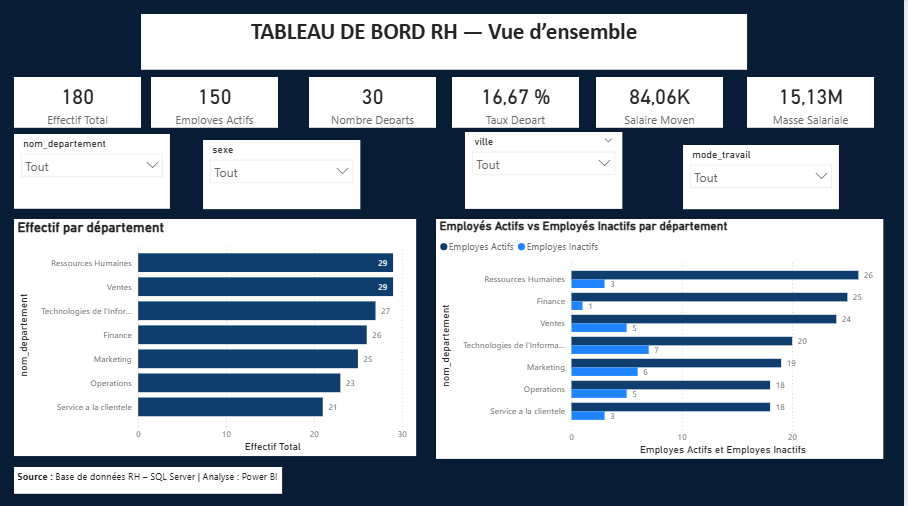
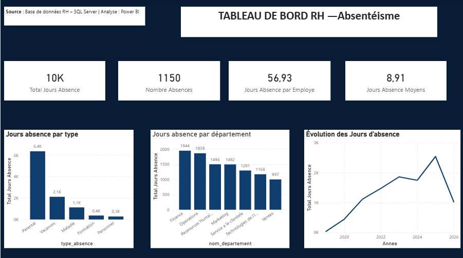
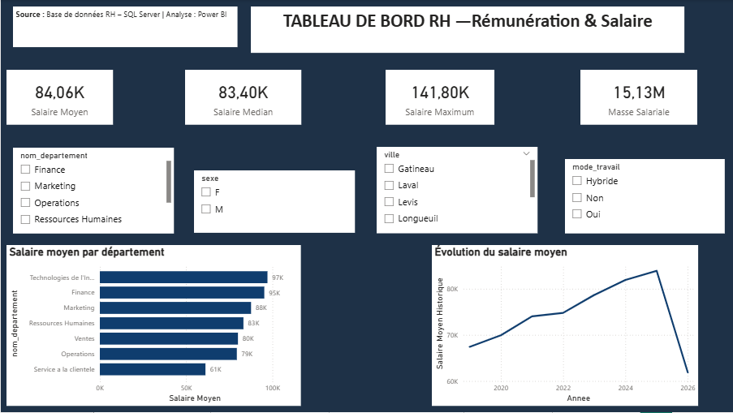
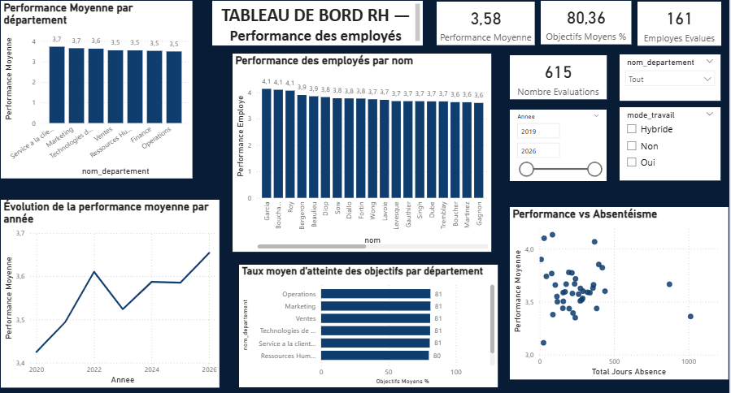

# HR Analytics | SQL Server & Power BI

## Présentation du projet

Ce projet d'analyse des ressources humaines vise à transformer
les données RH en informations utiles à la prise de décision.

À travers SQL Server et Power BI, il permet d'explorer les
effectifs, les départements, les salaires et les mouvements
du personnel afin de mieux comprendre la situation des
ressources humaines d'une organisation.

## Problématique

Comment exploiter les données RH pour mieux comprendre
la répartition des employés, suivre les mouvements
du personnel et faciliter les décisions de gestion ?

## Objectifs du projet

- Centraliser et préparer les données RH.
- Vérifier la cohérence et la qualité des données.
- Analyser les effectifs et leur répartition.
- Étudier les départs et leurs principaux motifs.
- Explorer les informations salariales.
- Concevoir des tableaux de bord interactifs.

## Technologies utilisées

| Technologie | Utilisation |
|---|---|
| SQL Server | Stockage et interrogation des données |
| SQL | Extraction et analyse des informations RH |
| Power Query | Nettoyage et transformation des données |
| Power BI | Visualisation et tableaux de bord |
| DAX | Création des indicateurs RH |

## Méthodologie

### 1. Préparation des données

- Importation des données dans SQL Server.
- Vérification des valeurs manquantes.
- Contrôle de la cohérence des informations.
- Préparation des tables pour l'analyse.

### 2. Modélisation et analyse

- Création des relations entre les tables.
- Préparation du modèle de données dans Power BI.
- Création de mesures DAX.
- Analyse des principaux indicateurs RH.

### 3. Visualisation

Conception de tableaux de bord interactifs
pour explorer les données RH et faciliter
leur interprétation.

## Tableaux de bord Power BI

Le projet HR Analytics comprend cinq tableaux de bord
interactifs permettant d'explorer les principaux
indicateurs de gestion des ressources humaines.

### 1. Vue d'ensemble des ressources humaines

Présentation des principaux indicateurs RH et
de la situation globale des effectifs.

### 2. Effectifs et turnover

Analyse de la répartition des employés et
des mouvements du personnel.

### 3. Absentéisme

Visualisation des indicateurs liés à l'absentéisme
et au suivi des absences.

### 4. Rémunération et salaires

Analyse des données salariales et
de la rémunération des employés.

### 5. Performance RH

Présentation des indicateurs de performance
des ressources humaines.

## Indicateurs analysés

- Nombre total d'employés.
- Répartition des employés par département.
- Employés actifs et inactifs.
- Départs par motif.
- Analyse des salaires.
- Évolution des indicateurs dans le temps.

## Tableaux de bord Power BI

Les tableaux de bord permettent de visualiser
les principaux indicateurs RH et d'explorer
les données selon différents critères.

Les captures d'écran seront ajoutées dans
cette section.

## Valeur ajoutée du projet

Ce projet illustre comment les outils
d'intelligence d'affaires peuvent contribuer
à une meilleure compréhension des ressources humaines.

Il permet notamment de :

- Centraliser les informations RH.
- Faciliter le suivi des effectifs.
- Identifier les tendances liées aux départs.
- Améliorer la lisibilité des indicateurs.
- Soutenir les décisions grâce à des visualisations interactives.

## 📂 Fichiers du projet

Les fichiers sources et les tableaux de bord sont disponibles ci-dessous :

-  [Consulter le script SQL Server](sql/)
-  [Accéder au rapport Power BI](powerbi/)
-  [Visualiser les tableaux de bord](images/)

## Compétences démontrées

SQL Server | SQL | Power BI | Power Query | DAX |
Data Cleaning | Data Modeling | Data Visualization |
Business Intelligence
